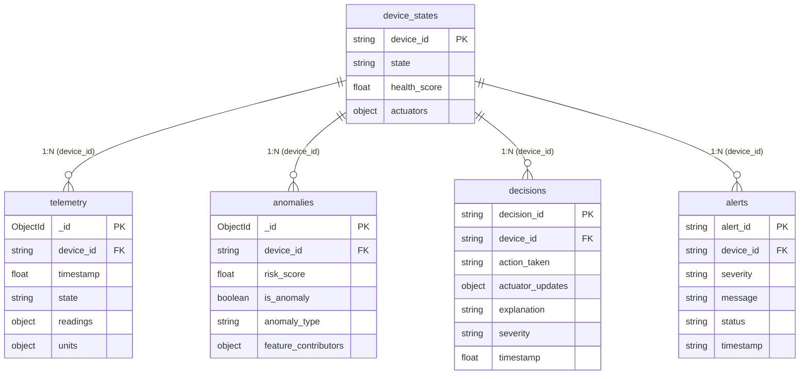

# ⚡ Autonomous IoT Decision and Alert Platform

[](https://www.python.org/)
[](https://streamlit.io/)
[](https://mqtt.org/)
[](https://www.mongodb.com/)
[](https://nodered.org/)
[](https://grafana.com/)
[](https://scikit-learn.org/)
[](LICENSE)

An enterprise-ready, closed-loop industrial **Autonomous IoT Decision and Alert Management Platform**. Senses multi-sensor machine telemetry over **MQTT**, detects abnormal conditions using **Isolation Forest** and **rolling Z-scores**, executes automated protective actuator trips in real time, and persists all records across five collections in **MongoDB** (`aiot_platform`). Features an interactive dark-mode web cockpit with live Plotly telemetry, an explainable decision audit log, alert lifecycle tracking (`ACTIVE` &rarr; `ACKNOWLEDGED` &rarr; `RESOLVED`), and a fault-injection test lab.

---

## 🎓 Academic Mini Project Report Details

| Project Metadata | Specification Details |
|:---|:---|
| **Project Title** | **Autonomous IoT Decision and Alert Platform** |
| **Student Name** | **Chinmay Prakash** |
| **Roll Number** | **2400320310060** |
| **Branch / Department** | **Electronics and Communication Engineering (ECE)** |
| **College Name** | **ABES Engineering College** |
| **Project Guide** | **Ashish Kumar** |
| **Year / Batch** | **B.Tech 3rd Year, Batch 2024–28** |
| **Academic Year** | **2026–27** |

---

## 🌟 Key Capabilities

1. **Four Simulated Industrial Assets**:
   - **`MCH-007` (Bottle Filling Machine)**: Monitors Temperature, Vibration, Pressure, Energy, and Fill Rate.
   - **`CNC-003` (Precision Milling)**: Monitors Spindle Temp, Vibration, Coolant Flow, Spindle RPM, and Motor Current.
   - **`CONV-012` (Logistics Conveyor)**: Monitors Motor Temp, Belt Tension, Belt Speed, and Motor Current.
   - **`ENV-001` (Air Quality & Safety Unit)**: Monitors Toxic Gas, Smoke Level, Ambient Temp, and Humidity.
2. **Closed-Loop Autonomous Protection**:
   - Detects faults within $\sim 2\text{ seconds}$ and immediately dispatches self-healing actuator commands:
     - `EMERGENCY_FAULT_STOP`: Fill valve closed, conveyor halted to 0, cooling switched to MAXIMUM.
     - `SPINDLE_SAFETY_TRIP`: Flood coolant engaged, spindle brake active.
     - `EMERGENCY_CONVEYOR_HALT`: Conveyor motor halted, diverter bypass activated.
     - `HAZMAT_EVACUATION_PURGE`: Industrial exhaust fans flushed at 100%, evacuation siren active.
3. **Machine Learning Anomaly Detection**:
   - **Isolation Forest** generates risk scores ($0.0 - 1.0$) to detect subtle multivariate correlations.
   - **Rolling Z-Score Detector** identifies the exact top sensor contributing to the deviation.
4. **Alert Lifecycle Management**:
   - Complete state machine: `ACTIVE` &rarr; `ACKNOWLEDGED` &rarr; `RESOLVED`.
5. **MongoDB Persistence (`aiot_platform`)**:
   - Five dedicated collections (`telemetry`, `anomalies`, `decisions`, `alerts`, `device_states`).
6. **Fault-Injection Test Lab**:
   - On-demand fault profiles: `SPIKE`, `DRIFT`, `OVERLOAD`, and `DROP`.
7. **Anywhere, Any-Device Access**:
   - Ready for 1-click deployment to **Streamlit Community Cloud** with a free, persistent public HTTPS URL.

---

## 🏗️ 5-Layer AIoT System Architecture

```
                  +-------------------------------------------------------------+
                  |                     EDGE ASSETS LAYER                       |
                  |     MCH-007 (Bottle Filling)     CNC-003 (Precision Mill)   |
                  |     CONV-012 (Conveyor)          ENV-001 (Air Quality Unit) |
                  +-------------------------------------------------------------+
                                       |                      ^
                     Telemetry Pub     |                      | Actuator Command /
                     (Port 1883)       v                      | Acknowledgement
                  +-------------------------------------------------------------+
                  |                    MESSAGING LAYER (MQTT)                   |
                  |       Topics: iot/telemetry/#  |  iot/commands/#  | iot/ack |
                  +-------------------------------------------------------------+
                                       |                      ^
                                       v                      |
                  +-------------------------------------------------------------+
                  |               ML & DECISION ENGINE LAYER                    |
                  |  - Isolation Forest Risk Scoring (0.0 to 1.0)               |
                  |  - Rolling Z-Score Sensor Contribution Analyzer             |
                  |  - Autonomous Threshold Rule Engine (Table 11 Matrix)       |
                  +-------------------------------------------------------------+
                                       |
                                       v Store Results
                  +-------------------------------------------------------------+
                  |                   PERSISTENCE LAYER (MongoDB)               |
                  |                   Database: aiot_platform                   |
                  |  [telemetry]  [anomalies]  [decisions]  [alerts]  [states]  |
                  +-------------------------------------------------------------+
                                       |
                                       v Read / Write Queries
                  +-------------------------------------------------------------+
                  |                   COCKPIT & API LAYER                       |
                  |  - Streamlit & Plotly High-Tech Cybernetic Dashboard        |
                  |  - Live Digital Twin Gauges & Multi-Sensor Time Series      |
                  |  - Explainable Autonomous Decision Audit Log                |
                  |  - Incident Lifecycle Manager & Fault-Injection Suite       |
                  +-------------------------------------------------------------+
```

---

## 🏭 Autonomous Protective Actions Matrix

| Asset Code | Industrial Asset | Sensor Envelopes & Trigger Condition | Autonomous Action Executed | Actuator Feedback Applied |
|:---|:---|:---|:---|:---|
| **`MCH-007`** | Bottle Filling Machine | $\text{Temp} \ge 88^\circ\text{C}$ OR $\text{Vib} \ge 4.0\text{ mm/s}$ OR $\text{Pressure} \le 4.0\text{ bar}$ | **`EMERGENCY_FAULT_STOP`** | Fill valve &rarr; `CLOSED`<br/>Conveyor &rarr; `0%`<br/>Cooling pump &rarr; `MAXIMUM` |
| **`CNC-003`** | Precision Milling Machine | $\text{Spindle Temp} > 85^\circ\text{C}$ OR $\text{Vibration} > 5.5\text{ mm/s}$ | **`SPINDLE_SAFETY_TRIP`** | Spindle &rarr; `STOPPED`<br/>Coolant &rarr; `FLOOD_COOLANT_MAX`<br/>Brake &rarr; `ENGAGED` |
| **`CONV-012`** | Logistics Conveyor | $\text{Motor Temp} > 80^\circ\text{C}$ OR $\text{Belt Tension} > 620\text{ N}$ | **`EMERGENCY_CONVEYOR_HALT`** | Drive motor &rarr; `STOPPED`<br/>Diverter &rarr; `BYPASS_ENGAGED` |
| **`ENV-001`** | Air Quality & Safety Unit | $\text{Gas} > 250\text{ ppm}$ OR $\text{Smoke} > 80\text{ ppm}$ | **`HAZMAT_EVACUATION_PURGE`** | Exhaust fan &rarr; `FLUSH_100%`<br/>Siren &rarr; `ON_ALERT`<br/>Air damper &rarr; `100%_OPEN` |

---

## 🗄️ Database Design (MongoDB: `aiot_platform`)

The system manages five logical collections in MongoDB:



| Collection | Key Fields | Purpose |
|:---|:---|:---|
| **`telemetry`** | `device_id`, `timestamp`, `state`, `readings`, `units` | Every streamed sensor reading, indexed by `(device_id, timestamp)`. |
| **`anomalies`** | `risk_score`, `is_anomaly`, `anomaly_type`, `feature_contributors` | Audit trail of ML evaluations and sensor contributions. |
| **`decisions`** | `decision_id`, `action_taken`, `actuator_updates`, `explanation`, `severity`, `timestamp` | Complete log of autonomous interventions with plain-text rationale. |
| **`alerts`** | `alert_id`, `severity`, `message`, `status`, `timestamps` | Incident lifecycle tracking (`ACTIVE` &rarr; `ACKNOWLEDGED` &rarr; `RESOLVED`). |
| **`device_states`**| `latest_state`, `health_score` (0–100%), `actuator_configuration` | Live operational status cards on the cockpit. |

---

## 🧪 Testing and Verification Results

| Test ID | Test Scenario | Execution Step | Expected Result | Status |
|:---:|:---|:---|:---|:---:|
| **TC01** | Platform Initialization | Launch via `streamlit run app.py` | MQTT, ML engine, simulator and web server start; cockpit opens | **PASS** ✅ |
| **TC02** | Telemetry Ingestion & Storage | Stream 4 assets | Live readings stored in `telemetry` collection and displayed on charts | **PASS** ✅ |
| **TC03** | MongoDB Status Inspection | Inspect database health tab | Connection state, database name and collection document counts returned | **PASS** ✅ |
| **TC04** | Inject Thermal Surge on `MCH-007` | Select `MCH-007` &rarr; `SPIKE` | Temperature rises above $88^\circ\text{C}$ within $\sim 2\text{s}$, health drops, state becomes `FAULT` | **PASS** ✅ |
| **TC05** | Autonomous Protective Execution | Trigger limit breach | `EMERGENCY_FAULT_STOP` executed; cooling MAXIMUM, conveyor 0%, explanation logged | **PASS** ✅ |
| **TC06** | Alert Lifecycle Transition | Click "Acknowledge" &rarr; "Resolve" | Alert status transitions from `ACTIVE` &rarr; `ACKNOWLEDGED` &rarr; `RESOLVED` in MongoDB | **PASS** ✅ |
| **TC07** | Latest Telemetry Retrieval | Query device data | Most recent asset telemetry document returned with zero delay | **PASS** ✅ |
| **TC08** | Manual Actuator Override | Send `START`, `STOP`, `THROTTLE` | Command dispatched over MQTT and recorded in database audit log | **PASS** ✅ |

---

## 🚀 Quickstart Guide

### 1. Run Locally
```bash
# Clone the repository
git clone https://github.com/prakashchinmay2211-bot/iot-autonomous-decision-platform.git
cd iot-autonomous-decision-platform

# Install dependencies
pip install -r requirements.txt

# Launch the platform
streamlit run app.py
```
Open **`http://localhost:8501`** in your browser.

---

### 2. Full-Stack Docker Deployment
Spin up Mosquitto, Node-RED, Grafana, and Streamlit with a single command:
```bash
docker compose up -d --build
```
* **Streamlit Platform**: `http://localhost:8501`
* **Node-RED Flows**: `http://localhost:1880`
* **Grafana Dashboards**: `http://localhost:3000` (`admin` / `admin`)
* **Mosquitto MQTT Broker**: Port `1883`

---

## 🌐 Deploy to Streamlit Community Cloud (Public Link for Anyone)

You can host this platform completely free so **anyone on any device** can access it via a public HTTPS link:

👉 **[Deploy to Streamlit Cloud under prakashchinmay2211@gmail.com](https://share.streamlit.io/deploy?repository=prakashchinmay2211-bot/iot-autonomous-decision-platform&branch=main&mainModule=app.py)**

1. Click the deployment link above.
2. Sign in with GitHub (`prakashchinmay2211-bot`).
3. Click **Deploy!**
4. Your platform will be accessible worldwide on any phone, tablet, or PC via a permanent URL.

---

## 📁 Repository Directory Structure

```
iot-autonomous-decision-platform/
├── app.py                      # Streamlit interactive web cockpit & digital twin
├── simulator.py                # Multi-asset industrial telemetry & fault simulator
├── database.py                 # MongoDB storage manager (5 collections + cloud fallback)
├── mqtt_client.py              # Resilient MQTT Pub/Sub manager
├── requirements.txt            # Python dependencies (Streamlit Cloud ready)
├── Dockerfile                  # Container definition for the web platform
├── docker-compose.yml          # Mosquitto + Node-RED + Grafana + Streamlit stack
├── README.md                   # Comprehensive project report & documentation
├── SRS.md                      # Dedicated Software Requirements Specification
├── .gitignore                  # Git ignore rules
├── .streamlit/
│   └── config.toml             # Custom high-contrast dark theme settings
├── ml/
│   ├── __init__.py
│   └── model.py                # Isolation Forest, Rolling Z-Scores & Decision Matrix
├── node_red/
│   ├── flows.json              # Production Node-RED flow definition
│   └── README.md               # Node-RED setup & webhook instructions
├── grafana/
│   ├── dashboards/
│   │   └── iot_autonomous_dashboard.json  # Pre-built Grafana telemetry dashboard
│   └── provisioning/
│       ├── dashboards/dashboards.yaml
│       └── datasources/datasources.yaml
└── mosquitto/
    └── config/
        └── mosquitto.conf      # Mosquitto broker configuration
```

---

## 📚 References
1. **HCL Career Shaper AIoT Curriculum** (Lectures 4–7) and *Autonomous IoT Platform – User & Architecture Guide*.
2. **Scikit-learn documentation**: IsolationForest — [https://scikit-learn.org](https://scikit-learn.org)
3. **MongoDB official documentation**: [https://www.mongodb.com/docs](https://www.mongodb.com/docs)
4. **MQTT specification & broker documentation**: [https://mqtt.org](https://mqtt.org)
5. **Chart.js documentation**: [https://www.chartjs.org/docs](https://www.chartjs.org/docs)
6. **Liu, F. T., Ting, K. M., Zhou, Z.-H.**, *“Isolation Forest,”* IEEE International Conference on Data Mining (ICDM), 2008.

---

## 📄 License
This project is open-source under the [MIT License](LICENSE).
